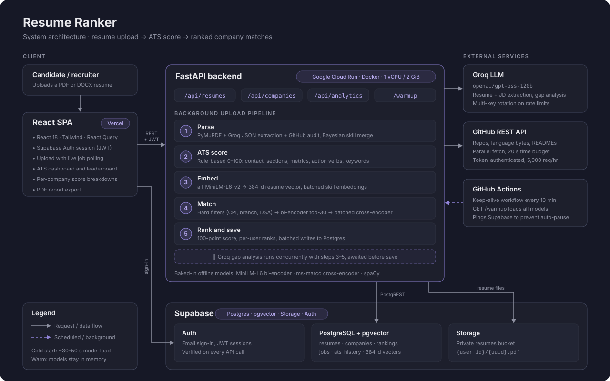

# Resume Ranker

**Upload a resume. Get an ATS score, a ranked list of companies you actually qualify for, and an audit of your GitHub — in one pass.**

[](https://resume-ranker-frontend-psi.vercel.app/)
[](server)
[](client)
[](server/migrations)
[](server/app/services/llm_service.py)
[](server/Dockerfile)

**[Try it live →](https://resume-ranker-frontend-psi.vercel.app/)**

---

## Why this exists

Most resume checkers give you one generic number and the same advice: *add keywords, use action verbs, quantify your impact.* None of them tell you which companies you're actually eligible for, or whether your resume matches the work you've really done.

Resume Ranker gives you three signals instead of one:

| Signal | What you get |
|---|---|
| **ATS score** | A 0–100 score with a five-part breakdown and AI-written feedback on what to fix |
| **Company match** | Your rank against every company in the index (currently 139), with real eligibility checks — CPI cutoff, allowed branches, DSA requirement — and the reason when you don't qualify |
| **GitHub audit** | If your resume links a GitHub profile, your public repos are scanned: language usage measured in bytes, skills pulled from READMEs, and projects matched to repos |

---

## Architecture



The React app on Vercel talks to a FastAPI service on Google Cloud Run. An upload returns immediately with a job ID; the heavy work runs as a background pipeline while the frontend polls for progress. Supabase provides Postgres (with `pgvector` for embeddings), file storage, and authentication.

For a full walkthrough of every service, endpoint, and design decision, see **[docs/project-overview.md](docs/project-overview.md)**.

---

## How a resume is processed

1. **Parse** — PyMuPDF extracts text and embedded links (catching GitHub/LinkedIn URLs hidden behind icons). Groq's LLM returns structured JSON for education, experience, and projects, with regex heuristics as a fallback. If a GitHub profile is found, repos, language byte counts, and READMEs are fetched in parallel under a 20-second budget.
2. **Merge** — Resume text, LLM output, and GitHub evidence vote on each skill through a Bayesian confidence update, so every skill carries both a confidence and its sources (`Resume`, `GitHub (Repo: 49.9%)`, …).
3. **ATS score** — A deterministic 0–100 score (no LLM), so the same resume always gets the same number.
4. **Embed** — The profile is encoded into a 384-dimensional vector with `all-MiniLM-L6-v2`.
5. **Match** — Hard filters remove companies you can't apply to. A fast bi-encoder picks the 30 most similar remaining companies, and only those get the expensive cross-encoder pass, batched into a single call.
6. **Rank and save** — Scores are ranked against your other uploads and written to Postgres. The LLM gap analysis runs concurrently with steps 4–6, so its network time doesn't add to the total.

### ATS score (100 points)

| Component | Points | Checks |
|---|---|---|
| Contact info | 15 | Email, phone, LinkedIn or GitHub |
| Formatting | 20 | Standard sections present and sensibly ordered |
| Quantifiable metrics | 25 | Numbers, percentages, and amounts in your bullet points |
| Action verbs | 25 | Variety of strong verbs, detected with spaCy |
| Keyword density | 15 | Whether listed skills actually appear in your project descriptions |

### Company match score (100 points)

| Component | Points | How it's computed |
|---|---|---|
| Skill overlap | 30 | Exact matches plus semantic similarity for related skills |
| Cross-encoder relevance | 30 | `ms-marco-MiniLM-L-6-v2` reads the job description against your profile |
| Academic fit | 15 | CPI above the cutoff, and branch fit for the role |
| Project relevance | 15 | Overlap between your project tech and what the company looks for |
| Experience | 10 | Relevant work experience |

---

## Tech stack

| Layer | Technology |
|---|---|
| Frontend | React 18, Tailwind CSS, TanStack React Query, Framer Motion, jsPDF |
| Backend | FastAPI, Python 3.10, Pydantic Settings |
| ML / NLP | sentence-transformers (MiniLM bi-encoder + ms-marco cross-encoder), spaCy, PyMuPDF, python-docx |
| LLM | Groq (`openai/gpt-oss-120b`), with Gemini and Ollama supported as alternatives |
| Data | Supabase — Postgres + `pgvector`, Storage, Auth |
| Deployment | Google Cloud Run (Docker), Vercel, GitHub Actions keep-alive |

---

## Getting started

### Prerequisites

- Python 3.10+ and Node.js 18+
- A [Supabase](https://supabase.com) project
- A free [Groq API key](https://console.groq.com/keys)
- Optional but recommended: a [GitHub token](https://github.com/settings/tokens) with **no scopes** (raises the GitHub API limit from 60 to 5,000 requests per hour)

### 1. Database

Run the SQL files in [`server/migrations/`](server/migrations) in order, in the Supabase SQL editor. Then create a Storage bucket named `resumes`.

### 2. Backend

```bash
cd server
python -m venv venv
venv\Scripts\activate          # macOS/Linux: source venv/bin/activate
pip install -r requirements.txt
python -m spacy download en_core_web_sm
cp .env.example .env           # then fill in the values below
uvicorn app.main:app --reload --port 8000
```

The first request takes 30–50 seconds while the ML models load. API docs are at `http://localhost:8000/docs`.

### 3. Frontend

```bash
cd client
npm install
cp .env.example .env.local     # then fill in the values below
npm start
```

The app runs at `http://localhost:3000`.

---

## Environment variables

**Backend — `server/.env`** (full list with comments in [`server/.env.example`](server/.env.example))

| Variable | Required | Purpose |
|---|---|---|
| `SUPABASE_URL` | Yes | Your Supabase project URL |
| `SUPABASE_SERVICE_ROLE_KEY` | Yes | Server-side Supabase key — never expose it to the frontend |
| `GROQ_API_KEYS` | Yes | One or more Groq keys, comma-separated, rotated on rate limits |
| `GROQ_MODEL_NAME` | No | Defaults to `openai/gpt-oss-120b` |
| `GITHUB_TOKEN` | Recommended | Raises the GitHub API limit for profile enrichment |
| `ENVIRONMENT` | Production | Set to `production` on the server |
| `FRONTEND_ORIGINS` | Production | Comma-separated allowed origins; the server refuses to start in production without it |

**Frontend — `client/.env.local`**

| Variable | Purpose |
|---|---|
| `REACT_APP_API_URI` | Backend URL, e.g. `http://localhost:8000/api` |
| `REACT_APP_SUPABASE_URL` | Supabase project URL |
| `REACT_APP_SUPABASE_ANON_KEY` | Supabase public anon key |

> Frontend variables are bundled into the browser build and are public. Only the anon key belongs there — never the service-role key, Groq keys, or GitHub token.

---

## Project structure

```
├── client/                 React frontend (Vercel)
│   └── src/
│       ├── pages/          Dashboard, ATS dashboard, candidate profile, leaderboard
│       ├── components/     Upload, score cards, company match breakdowns
│       └── services/       API client — every backend call goes through here
├── server/                 FastAPI backend (Cloud Run)
│   ├── app/
│   │   ├── api/endpoints/  resumes, companies, analytics routes
│   │   ├── core/           settings, database client, JWT auth
│   │   └── services/       parser, LLM, embeddings, matcher, ranking, ATS, GitHub
│   ├── data/               skill taxonomy, branch equivalences
│   ├── migrations/         Postgres schema (apply in order)
│   └── Dockerfile          bakes ML models into the image, verified at build time
├── docs/                   architecture diagram and project overview
└── .github/workflows/      keep-alive job for Cloud Run and Supabase
```

---

## Deployment

- **Backend** — Docker image on Google Cloud Run (1 vCPU, 2 GiB). All three ML models are downloaded at build time, and the build fails if they can't be loaded offline, so a broken image never ships. Instance-based billing gives the background pipeline full CPU after the HTTP response returns.
- **Frontend** — Vercel, with `REACT_APP_API_URI` pointing at the Cloud Run URL.
- **Keep-alive** — A GitHub Actions workflow calls `/warmup` every 10 minutes to keep the models loaded, and pings Supabase so the free-tier project doesn't auto-pause.

A typical upload takes about 15 seconds on a warm container, mostly LLM extraction and cross-encoder re-ranking. A cold start adds 30–50 seconds for model loading.

---

## Contributors

| | |
|---|---|
| **Aditya Gupta** ([@adi-kernelx](https://github.com/adi-kernelx)) | ML pipeline — resume parser, LLM extraction, GitHub enrichment, embeddings, company matching — plus the Groq migration and backend performance work |
| **Aditya Onam** ([@AdityaOnam](https://github.com/AdityaOnam)) | Migration to FastAPI and Supabase, ATS dashboard and UI redesign, deployment |
